# Legacy Roofing CRM — Architecture

| Field | Value |
|---|---|
| Document | `docs/ARCHITECTURE.md` |
| Version | 0.1 — Draft |
| Date | 2026-11-04 |
| Related | [PRD.md](./PRD.md) · [TECH_STACK.md](./TECH_STACK.md) · [CURSOR_RULES.md](./CURSOR_RULES.md) · [DECISIONS.md](./DECISIONS.md) |

Requirement IDs (e.g., `EST-005`) refer to PRD.md. Decision IDs (e.g., `D-010`) refer to DECISIONS.md. Where this document describes a [P] (proposed) behavior from the PRD, it is the working design and may change when the linked question is answered.

---

## 1. Architectural Principles

1. **Modular monolith.** One backend codebase, one database, clear module boundaries. No microservices.
2. **Two backend processes, one codebase.** `server.ts` (HTTP API) and `worker.ts` (BullMQ workers, Playwright).
3. **Backend is the authority** for permissions, calculations, numbering, balances and status transitions.
4. **Integrations behind adapters.** Core modules depend on a capability interface, never on a vendor SDK.
5. **Single organization.** No `tenantId`. Company-specific values (branding, pricing, stages) live in database configuration, not code, which keeps future commercialization possible without building SaaS now (D-009).
6. **Build only what a requirement needs.** Modules, folders, infrastructure and dependencies are introduced when their phase starts (TECH_STACK §14); development proceeds strictly phase by phase (PROJECT §7).

## 2. System Architecture

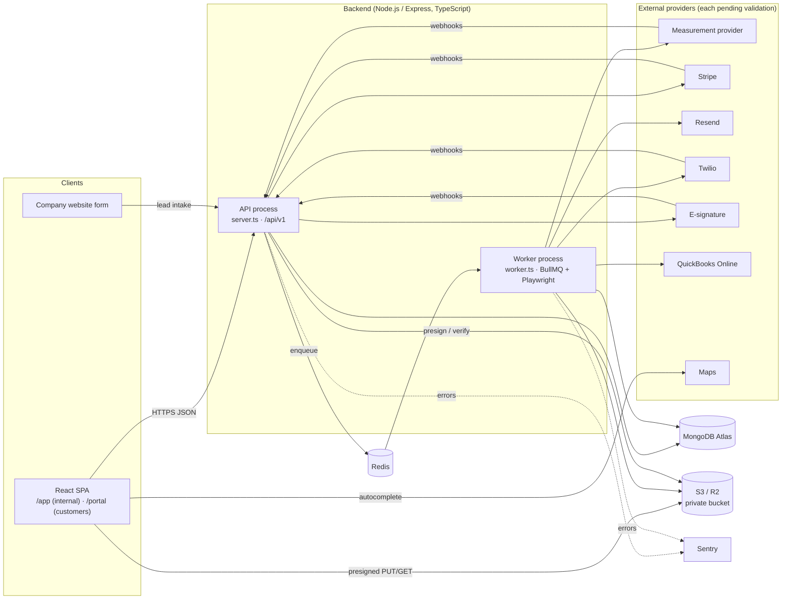

This is the target architecture. Components appear in the phase listed in TECH_STACK §14 (e.g., Redis, the worker and Sentry are not part of Phase 1).

## 3. Frontend Structure

```
frontend/src/
  main.tsx                # bootstraps router, QueryClient (Sentry added when introduced)
  app/                    # router definition, providers, route guards
  layouts/                # AppLayout (internal), PortalLayout, AuthLayout
  pages/                  # thin route components that compose module components
  modules/                # business domains
    auth/  leads/  customers/  appointments/  inspections/  measurements/
    estimates/  catalog/  projects/  invoices/  communications/  portal/  ...
      api.ts              # TanStack Query hooks + query keys for this domain
      components/         # domain components
      schemas.ts          # Zod form schemas
      types.ts            # domain types (API DTO shapes)
  components/
    ui/                   # shadcn/ui components
    shared/               # cross-domain components (DataTable, EmptyState, ErrorState, PageHeader…)
  hooks/                  # cross-domain hooks only
  services/
    http.ts               # single fetch wrapper: base URL, bearer token, refresh-on-401, error normalization
  stores/                 # Zustand: auth session, UI preferences
  lib/                    # utilities: cn(), money/date formatting, permission helpers
  types/                  # global types only (API envelope, pagination)
```

**Rules**

- Pages do not call `fetch`; they use module `api.ts` hooks. Hooks use `services/http.ts`.
- Query keys are defined once per module (e.g., `leadKeys.list(filters)`), and mutations invalidate the affected keys.
- Server data is never copied into Zustand.
- Money is formatted from integer cents in one formatter in `lib/`; the UI never computes authoritative totals (EST-012).
- Internal and portal route trees are separate. A portal session cannot render internal routes.
- Folders under `modules/` are created when the module is implemented, not in advance.

**Routing (top level)**

| Path | Layout | Guard |
|---|---|---|
| `/login`, `/reset-password`, `/accept-invite` | AuthLayout | Public |
| `/app/*` | AppLayout | Internal session + permission per route |
| `/portal/login`, `/portal/accept-invite` | AuthLayout | Public |
| `/portal/*` | PortalLayout | Portal session |

## 4. Backend Module Structure

```
backend/src/
  app.ts                  # Express app: middleware, routers, error handler (no listen)
  server.ts               # HTTP entry: env check, DB connect, listen, graceful shutdown
  worker.ts               # Worker entry: DB connect, register BullMQ workers
  config/
    env.ts                # Zod-validated environment variables (fail fast)
    permissions.ts        # role → permission map
  middleware/
    authenticate.ts  authorize.ts  validate.ts  rate-limit.ts  request-id.ts  error-handler.ts
  modules/
    <module>/
      <entity>.model.ts
      <entity>.service.ts
      <entity>.controller.ts
      <entity>.routes.ts
      <entity>.validation.ts
      <entity>.types.ts
      <entity>.service.test.ts / <entity>.routes.test.ts
  integrations/
    storage/              # S3-compatible client
    measurements/         # MeasurementProvider interface + providers/manual-import + validated providers only
    payments/stripe/
    email/resend/
    sms/twilio/
    signatures/           # SignatureProvider interface + selected provider
    accounting/quickbooks/
    maps/                 # selected provider
  jobs/
    queues.ts             # queue names and enqueue helpers
    workers/              # one file per queue processor
  services/               # cross-module domain services only (e.g., numbering, pdf rendering, audit)
  utils/                  # pure helpers (errors, money, phone normalization, pagination)
```

**Module file layout (D-022).** The brief suggests `model/ controller/ service/ routes/ validation/ types/` sub-folders. To avoid folders that contain one file, each concern is a single file named `<entity>.<concern>.ts` inside the module folder. A concern is promoted to a sub-folder only when it grows beyond one file. This is equivalent in separation of responsibilities and is pending approval in DECISIONS.md.

**Layering rules**

```
routes → middleware (authenticate, authorize, validate) → controller → service → model
```

- **Routes:** path, middleware chain, controller binding.
- **Controller:** read validated input and `req.auth`, call one service method, send the response. No business logic, no model access.
- **Service:** business logic, record scope, transactions, audit entries, enqueueing jobs.
- **Model:** Mongoose schema, indexes, no business logic beyond schema-level validation.
- **Cross-module access:** a module uses another module's **service**, never its model directly (prevents duplicated rules). Exception: read-only aggregation in `analytics` may query models directly for performance.

**Backend modules**

| Module | Responsibility | Phase |
|---|---|---|
| `auth` | Login, refresh, logout, password change/reset, invites (internal + portal flows) | 1 |
| `users` | Internal user CRUD, roles | 1 |
| `settings` | Company settings, lookup values, pipeline stages, templates (payment schedule, checklist) | 1+ |
| `audit` | Audit log write/read | 1 |
| `leads` | Leads, intake, assignment, duplicates, conversion | 2 |
| `activities` | Notes, calls, follow-ups, timeline entries | 2 |
| `customers` | Customers and properties | 2 |
| `appointments` | Appointments | 3 |
| `files` | Upload intents, confirmation, metadata, signed URLs, annotations | 3 |
| `inspections` | Inspections | 3 |
| `projects` | Projects (core in 3; full in 6), tasks, work orders, checklists | 3/6 |
| `reports` | Photo report generation | 3 |
| `measurements` | Measurement versions, provider orchestration | 4 |
| `catalog` | Catalog items, suppliers | 4/5 |
| `estimates` | Estimates, templates, calculation engine, approvals | 4/5 |
| `signatures` | Signature requests and provider webhooks | 5 |
| `materials` | Material lists and orders | 5 |
| `subcontractors` | Subcontractor directory | 6 |
| `invoices` | Payment schedules, invoices, numbering | 7 |
| `payments` | Payments, receipts, Stripe checkout/webhooks | 7 |
| `accounting` | QuickBooks connection and sync | 7 |
| `communications` | Messages, templates, consents, inbound SMS | 8 |
| `notifications` | In-app notifications | 2+ |
| `portal` | Portal-scoped read/act endpoints | 8 |
| `after-sales` | Warranties, feedback, review requests | 8 |
| `analytics` | Dashboard and reports aggregation | 2+ |

## 5. Database Collection Design

Conventions: collection names are plural camelCase; every document has `createdAt`, `updatedAt` (Mongoose timestamps) and, where user-created, `createdBy`. Money fields end in `Cents` (integer). Percentages end in `Bp` (basis points, integer; 5000 = 50%). References are `ObjectId` with `ref`. Soft deletion uses `archivedAt`/`deletedAt` where the PRD requires it.

| Collection | Key fields | Indexes (in addition to `_id`) |
|---|---|---|
| `users` | email (lowercase), passwordHash, firstName, lastName, phone, role, isActive, receivesLeads, mustChangePassword, lastLoginAt | `email` unique; `role,isActive` |
| `refreshSessions` | principalType (`user`/`portal`), principalId, tokenHash, familyId, expiresAt, revokedAt, replacedBy, userAgent, ip | `tokenHash` unique; `principalId`; TTL on `expiresAt` |
| `portalAccounts` | customerId, email, passwordHash, contactName, isActive, invitedBy, lastLoginAt | `email` unique; `customerId` |
| `authTokens` | purpose (`password_reset`/`invite`), principalType, principalId, tokenHash, expiresAt, usedAt | `tokenHash` unique; TTL on `expiresAt` |
| `companySettings` | single document: branding, contact, timezone, defaults (wasteBp, marginBp, estimateExpiryDays), taxRates[], terms texts, invoice settings (autoIssue, numberPrefix), leadAssignment config | — (singleton) |
| `lookupValues` | type (enum: lead_source, lost_reason, property_type, appointment_type, photo_category, slope_tag, damage_tag, material_category, project_category, warranty_type), key, label, order, isActive | `type,key` unique; `type,order` |
| `pipelineStages` | pipeline (`lead`/`project`), name, category (`open`/`won`/`lost` or `pre_sale`/`production`/`completed`/`cancelled`), order, isActive | `pipeline,order`; `pipeline,name` unique |
| `counters` | _id (e.g., `invoice:2026`), seq | — |
| `leads` | firstName, lastName, companyName, email, emailNormalized, phone, phoneE164, address{line1,line2,city,state,zip}, addressKey, sourceKey, stageId, assignedTo, serviceInterestKey, referredByCustomerId, possibleDuplicateOf[], lostReasonKey, convertedCustomerId, convertedAt, externalSubmissionId | `assignedTo,stageId`; `phoneE164`; `emailNormalized`; `addressKey`; `externalSubmissionId` unique sparse; `createdAt`; text index on names |
| `activities` | entityType (`lead`/`customer`/`project`), entityId, type (`note`/`call`/`follow_up`/`stage_change`/`assignment`/`conversion`/`system`), body, dueAt, completedAt, assignedTo, metadata, createdBy | `entityType,entityId,createdAt`; `assignedTo,completedAt,dueAt` |
| `customers` | type, firstName, lastName, companyName, email, emailNormalized, phone, phoneE164, contacts[] (embedded, small), mailingAddress, ownerId, notes, archivedAt | `ownerId`; `phoneE164`; `emailNormalized`; text index on names |
| `properties` | customerId, address, addressKey, propertyTypeKey, details{stories, roofAgeYears, notes}, location{lat,lng} | `customerId`; `addressKey` |
| `appointments` | leadId?, customerId?, propertyId?, projectId?, typeKey, startAt, endAt, location, assignedTo, status, cancelReason, notes | `assignedTo,startAt`; `customerId`; `leadId` |
| `projects` | customerId, propertyId, categoryKey, name, assignedTo, stageId, plannedStart/End, actualStart/End, contractTotalCents, approvedEstimateId, subcontractors[{subcontractorId, trade, notes}], checklist[{label, required, checkedAt, checkedBy}], paymentSchedule[{label, type, valueBp/amountCents, trigger, invoiceId}], currentMeasurementId | `customerId`; `propertyId`; `assignedTo,stageId`; `subcontractors.subcontractorId` |
| `tasks` | projectId, title, description, assignedTo, dueAt, status | `projectId`; `assignedTo,status,dueAt` |
| `workOrders` | projectId, subcontractorId, number, scope, scheduledDate, instructions, materialsSummary, status, pdfFileId | `projectId`; `subcontractorId` |
| `subcontractors` | name, companyName, trades[], phone, email, notes, isActive | `name` |
| `checklistTemplates` | projectCategoryKey, items[{label, required, order}] | `projectCategoryKey` unique |
| `inspections` | propertyId, projectId?, customerId, inspectedAt, inspectorId, status, notes | `propertyId`; `projectId` |
| `fileAssets` | kind (`photo`/`document`/`report`/`measurement_report`/`proposal`/`signed_document`/`invoice_pdf`/`receipt`/`work_order`/`warranty_document`), status (`pending_upload`/`ready`/`rejected`), storageKey, thumbnailKey, mimeType, sizeBytes, originalName, context{customerId, propertyId?, projectId?, inspectionId?, entityType?, entityId?}, photo{category, tags[], caption, phase, capturedAt, gps{lat,lng,accuracyM,source}, annotations[]}, portalVisible, version, uploadedBy, deletedAt | `context.customerId`; `context.projectId,kind`; `context.inspectionId`; `storageKey` unique |
| `photoReports` | inspectionId, propertyId, projectId?, photoIds[] (ordered), status, fileId, version, portalVisible, error | `inspectionId`; `projectId` |
| `measurements` | projectId, propertyId, version, source (`manual_import`/provider key), status, providerOrderRef, requestedBy, data{normalized fields}, reportFileId, rawPayloadFileId, error, completedAt | `projectId,version` unique; `source,providerOrderRef` unique sparse; `status` |
| `catalogItems` | kind, name, sku, categoryKey, unit, unitCostCents, marginBp?, taxable, supplierId?, estimating{basis, coveragePerUnit, applyWaste, rounding}, isActive | `kind,isActive`; `sku` unique sparse; `categoryKey` |
| `suppliers` | name, contactName, phone, email, accountNumber, address, notes, isActive | `name` |
| `estimateTemplates` | name, projectCategoryKey, options[{label, lines[{catalogItemId, description, defaultQuantity?}]}], isActive | `projectCategoryKey` |
| `estimates` | projectId, customerId, number, revision, status, measurementId?, measurementSnapshot, options[{label, description, wasteBp, discount{type, value}, taxRateId, lines[], totals{subtotalCents, discountCents, taxCents, totalCents, costCents, grossProfitCents}}], selectedOptionIndex, expiresAt, sentAt, approval{method, approverName, approverEmail, approvedByUserId, approvedAt, ip, signedFileId, optionIndex}, supersededBy, proposalFileId | `number,revision` unique; `projectId`; `status,expiresAt` |
| `signatureRequests` | estimateId, provider, providerRequestId, status, signerEmail, events[], signedFileId | `provider,providerRequestId` unique |
| `materialOrders` | projectId, supplierId, number, items[{catalogItemId, name, unit, quantity, unitCostCents}], status, orderedAt, expectedDeliveryAt, supplierReference, notes | `projectId`; `supplierId,status` |
| `invoices` | projectId, customerId, number?, status, scheduleItemIndex?, lines[{description, quantity, unitPriceCents, taxable, amountCents}], subtotalCents, discountCents, taxCents, totalCents, amountPaidCents, balanceDueCents, issuedAt, dueAt, voidedAt, voidReason, pdfFileId | `number` unique sparse; `projectId`; `customerId`; `status,dueAt` |
| `payments` | invoiceId, projectId, customerId, type (`payment`/`refund`), amountCents, method, status (`pending`/`succeeded`/`failed`), receivedAt, reference, provider?, providerPaymentId?, recordedBy, receiptFileId | `invoiceId`; `provider,providerPaymentId` unique sparse; `receivedAt` |
| `messages` | channel (`email`/`sms`), direction, customerId?, leadId?, projectId?, to, from, subject, body, templateKey, tag, status, providerMessageId, error, sentBy | `customerId,createdAt`; `leadId,createdAt`; `providerMessageId` |
| `messageTemplates` | key, channel, name, subject, body, isActive | `key,channel` unique |
| `contactConsents` | phoneE164 or email, channel, status, source, consentText, recordedBy, customerId?, leadId? | `channel,phoneE164`; `channel,email` |
| `notifications` | userId, type, title, link, readAt | `userId,readAt,createdAt` |
| `warranties` | projectId, customerId, typeKey, provider, registrationNumber, startDate, endDate, coverageNotes, documentFileIds[] | `projectId`; `customerId`; `endDate` |
| `customerFeedback` | projectId, customerId, rating, comments, source, reviewRequest{sentAt, channel, outcome} | `projectId`; `customerId` |
| `integrationConnections` | provider, status, encryptedTokens, scopes, externalAccountId, connectedBy, connectedAt | `provider` unique |
| `syncRecords` | provider, entityType, entityId, externalId, status, lastAttemptAt, attempts, lastError | `provider,entityType,entityId` unique; `status` |
| `integrationEvents` | provider, eventId, type, receivedAt, processedAt, status, error | `provider,eventId` unique; TTL optional |
| `auditLogs` | actorType, actorId, action, entityType, entityId, changes, requestId, ip, createdAt | `entityType,entityId,createdAt`; `actorId,createdAt`; `action,createdAt` |

**Why embedded vs referenced:** estimate options/lines, project checklist and payment schedule items, customer contacts and invoice lines are bounded, always read with their parent and change with it → embedded. Photos, invoices, payments, measurements and estimates have their own lifecycle, permissions or volume → separate collections.

**Normalization keys.** `phoneE164`, `emailNormalized` and `addressKey` (lowercased, punctuation removed, common suffixes normalized, + ZIP) are computed in the service on write — the single implementation lives in `utils/` and is used by leads and customers.

## 6. Entity Relationships

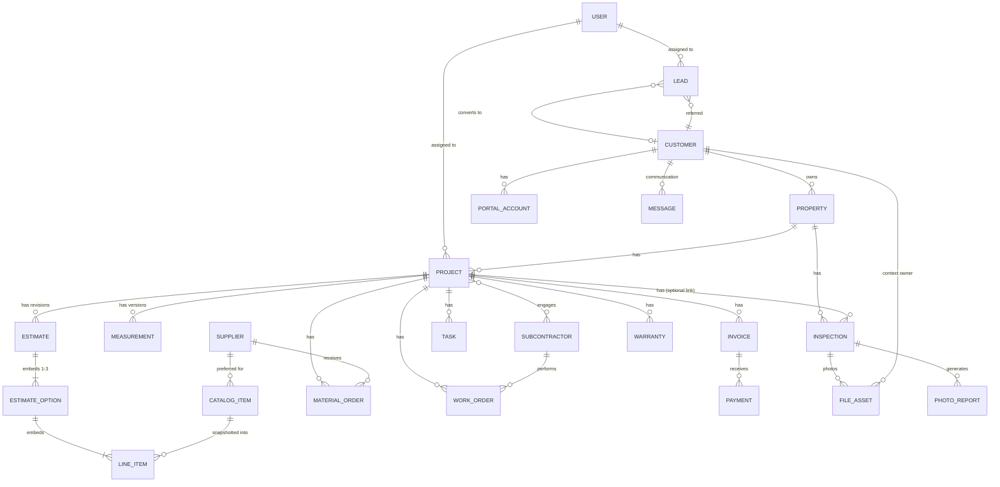

**Context integrity (BR-11).** Every `fileAssets.context.customerId` is required. When `projectId` or `inspectionId` is set, the service verifies they belong to the same customer and property. The same check applies to appointments, measurements, estimates and invoices.

## 7. Authentication Flow

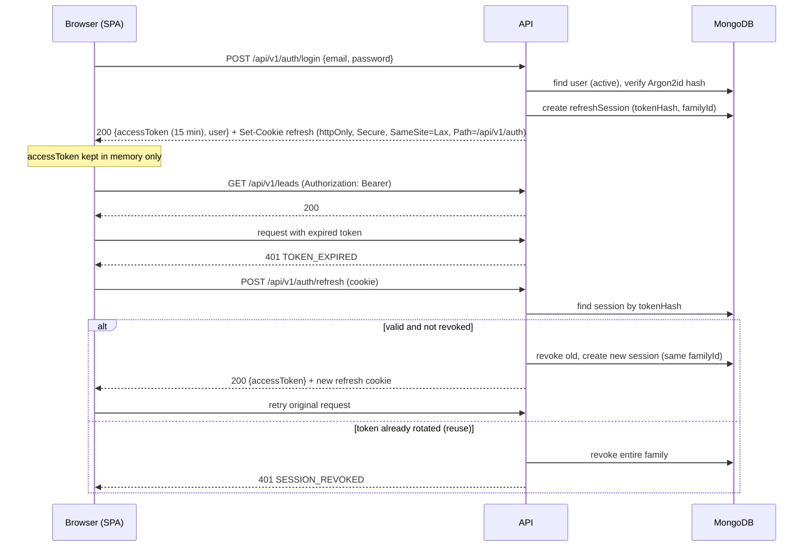

- Access token claims: `sub`, `aud` (`internal` or `portal`), `role` (internal only), `customerId` (portal only), `iat`, `exp`. Signed with HS256 using a strong secret (or RS256 if later required).
- `authenticate` middleware verifies signature, expiry and audience, then loads the principal and rejects inactive users (cached briefly per request only).
- On page reload the SPA calls `/auth/refresh` once to obtain a new access token.
- The refresh cookie is sent only to the auth path. Because the access token is sent as a header, normal API calls are not CSRF-exposed; the refresh endpoint additionally checks the `Origin` header against the allow-list.
- Portal authentication uses the same mechanism under `/api/v1/portal/auth/*` with `aud=portal` (SEC-016).

## 8. Authorization Flow

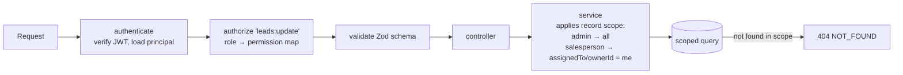

- **Permissions** are strings `resource:action` (e.g., `leads:read`, `leads:assign`, `invoices:issue`) defined in `config/permissions.ts`. Roles map to permission sets. Adding a role = editing this map (AUTH-004).
- **Record scope** is enforced inside services by a single helper per module (e.g., `leadScopeFilter(auth)`), merged into every query, including updates and deletes. Never fetch-then-check in the controller.
- **Portal scope:** all portal services take `customerId` from the token and include it in every query.
- **Field-level protection:** cost and margin fields are removed in the portal serializers; the internal API returns them only to permitted roles.

## 9. API Organization

Base path: `/api/v1`. JSON only. Resource-oriented nouns, plural. Actions that are state transitions use explicit sub-resources (e.g., `POST /estimates/:id/send`) rather than generic PATCH of `status`.

**Response envelope**

```json
{ "data": { }, "meta": { "page": 1, "pageSize": 25, "total": 120 } }
```
```json
{ "error": { "code": "VALIDATION_ERROR", "message": "Some fields are invalid.", "details": [{ "path": "phone", "message": "Invalid phone number" }], "requestId": "…" } }
```

**Status codes:** 200 read/update, 201 create, 204 no content, 400 malformed, 401 unauthenticated, 403 forbidden (permission), 404 not found or out of scope, 409 conflict (duplicate, version conflict, invalid state transition), 422 business rule violation, 429 rate limited, 500 unexpected (generic message only), 502/503 upstream provider failure (safe message).

**Pagination/filtering:** `?page=1&pageSize=25&sort=-createdAt&<filters>`; max `pageSize` 100.

**Endpoint groups** (indicative; each module's routes file is the source of truth, and any new or changed important endpoint must be reflected in this table in the same pull request)

| Group | Examples |
|---|---|
| `/auth` | **Phase 1:** `POST login`, `POST refresh`, `POST logout`, `GET me`, `POST password/change`, `POST password/forgot`, `POST password/reset`, `POST invites/accept` (email delivery disabled until INT-03) |
| `/users` | **Phase 1:** `GET /`, `GET /:id`, `POST /`, `PATCH /:id`, `POST /:id/deactivate` |
| `/settings` | **Phase 1:** `GET/PATCH /company`, `GET/POST /lookups/:type`, `PATCH /lookups/:type/:id`. **Phase 2:** `GET/POST /pipeline-stages`, `POST /pipeline-stages/reorder`, `PATCH /pipeline-stages/:id`. Later: `/payment-schedule-templates`, `/checklist-templates` |
| `/audit-logs` | **Phase 1:** `GET /` (admin, filterable) |
| `/leads` | **Phase 2:** list/create/get/update, `POST duplicate-check`, `POST /:id/stage`, `POST /:id/assign`, `POST /:id/convert` |
| `/activities` | **Phase 2:** list by entity, create, `POST /:id/complete` |
| `/customers`, `/properties` | **Phase 2:** CRUD, `POST /customers/:id/archive`, `GET /customers/:id/summary`, nested properties |
| `/notifications` | **Phase 2:** list, unread-count, `POST /:id/read`, `POST read-all` |
| `/analytics` | **Phase 2:** `GET /dashboard` (lead/customer tiles) |
| `/appointments` | list by range/assignee, CRUD, `POST /:id/cancel`, `POST /:id/complete` |
| `/files` | `POST upload-intents`, `POST /:id/confirm`, list by context, `GET /:id/url`, `PATCH /:id` (tags, caption, annotations), `DELETE /:id` |
| `/inspections`, `/photo-reports` | CRUD; `POST /photo-reports` (enqueue), `GET /photo-reports/:id` |
| `/measurements` | `POST` (provider request), `POST manual-import`, list by project, `GET /:id`, `POST /:id/retry`, `POST /:id/set-current` |
| `/catalog-items`, `/suppliers`, `/estimate-templates` | CRUD |
| `/estimates` | create, get, `PATCH /:id` (draft only; returns recalculated totals), `POST /:id/revisions`, `POST /:id/send`, `POST /:id/record-approval`, `POST /:id/decline`, `GET /:id/proposal-url` |
| `/projects` | CRUD, `POST /:id/stage`, `/:id/tasks`, `/:id/checklist/:itemIndex/check`, `/:id/material-list`, `/:id/payment-schedule` |
| `/work-orders`, `/material-orders`, `/subcontractors` | CRUD + status transitions |
| `/invoices` | list, create manual, get, `POST /:id/issue`, `POST /:id/void`, `GET /:id/pdf-url` |
| `/payments` | list, `POST` (manual), `POST /:id/refund`, `POST /invoices/:id/checkout-session` |
| `/accounting/quickbooks` | `GET status`, `GET connect`, `GET callback`, `POST disconnect`, `GET sync-records`, `POST sync-records/:id/retry` |
| `/messages`, `/message-templates`, `/consents` | list, send email/SMS, template CRUD, consent records |
| `/notifications` | list, `POST /:id/read`, `POST read-all` |
| `/warranties`, `/feedback` | CRUD, `POST /feedback/review-requests` |
| `/analytics` | `GET dashboard`, `GET reports/:reportKey` |
| `/portal/*` | `auth/*`, `projects`, `estimates/:id`, `estimates/:id/accept`, `reports`, `invoices`, `invoices/:id/checkout-session`, `warranties` |
| `/public/website-leads` | **Phase 2:** `POST` (header `X-Website-Lead-Secret`, honeypot, idempotent `submissionId`) |
| `/webhooks/:provider` | `stripe`, `twilio`, `signatures`, `measurements` |

## 10. File Upload Workflow

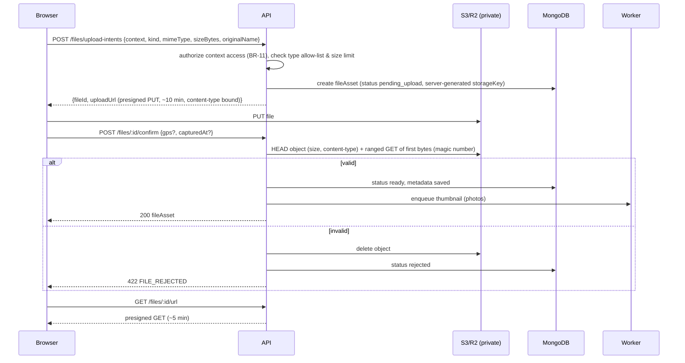

- Object key format: `<env>/<customerId>/<kind>/<yyyy>/<mm>/<fileId>.<ext>` — never derived from the original filename.
- Allowed types: photos `image/jpeg`, `image/png`, `image/webp` (+ `image/heic` subject to R-08); documents `application/pdf`. Max sizes from config (photos 20 MB, PDFs 25 MB) [P].
- GPS comes from the browser Geolocation API at upload time with permission, otherwise EXIF parsed client-side when present; stored with `source` (`device`/`exif`).
- Annotations are stored as JSON in `photo.annotations[]` using normalized coordinates (0–1) so they render identically at any size; the original object is never modified.
- `pending_upload` records older than 24 hours are cleaned by a scheduled job.

## 11. Estimate Calculation Workflow

The calculation engine is a pure, side-effect-free module (`modules/estimates/estimate.calculator.ts`) used by the estimate service. It is the only implementation of these formulas.

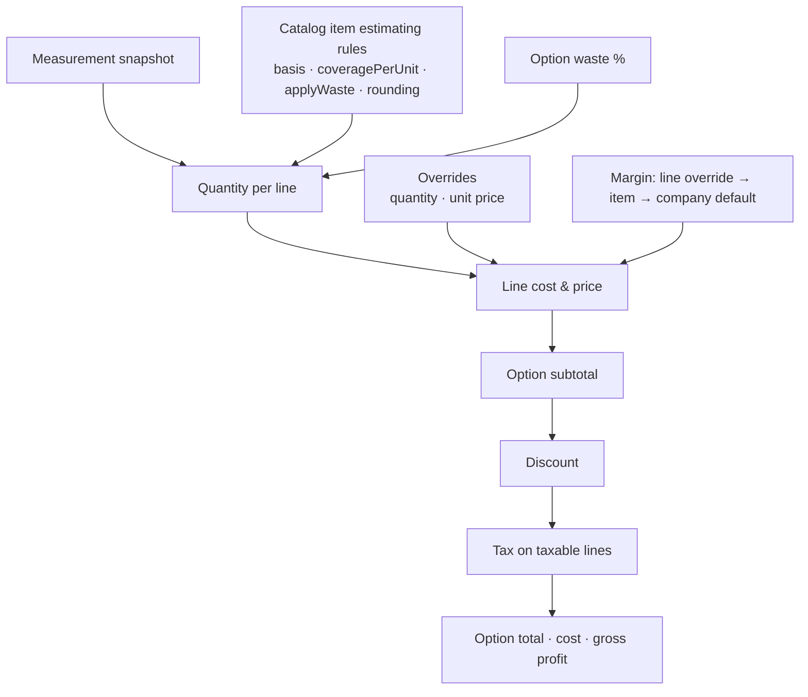

**Formulas** (decimal.js internally; money rounded half-up to cents at the marked steps):

1. `basisValue` = measurement value for `basis` (`roof_squares`, `area_sq_ft`, `eave_ft`, `rake_ft`, `eave_plus_rake_ft`, `ridge_ft`, `hip_ft`, `ridge_plus_hip_ft`, `valley_ft`, `flashing_ft`, `step_flashing_ft`) or `fixed` (manual quantity).
2. `rawQty = basisValue × (applyWaste ? 1 + wasteBp/10000 : 1) ÷ coveragePerUnit`.
3. `qty = round(rawQty, rounding)` where `rounding` ∈ `up_whole` (default for materials), `nearest_hundredth` (e.g., labor per square). A quantity override replaces `qty`; the calculated value is kept as `calculatedQuantity`.
4. `unitPriceCents = override ?? round_cents(unitCostCents ÷ (1 − marginBp/10000))`; `marginBp` must be `< 10000`.
5. `lineCostCents = round_cents(qty × unitCostCents)`; `lineTotalCents = round_cents(qty × unitPriceCents)`.
6. `subtotalCents = Σ lineTotalCents`.
7. `discountCents` = fixed amount, or `round_cents(subtotal × pctBp/10000)`; must be `≤ subtotal`.
8. Discount is allocated to taxable lines proportionally: `taxableBase = Σ taxable lineTotal × (1 − discount/subtotal)`; `taxCents = round_cents(taxableBase × taxRateBp/10000)`.
9. `totalCents = subtotal − discount + tax`; `costCents = Σ lineCost`; `grossProfitCents = subtotal − discount − cost`.

Example (AC-EST-1): area 2,500 sq ft → 25 squares; waste 10%; coverage 1/3 square per bundle (i.e., 3 bundles/square) → `ceil(25 × 1.10 ÷ (1/3)) = ceil(82.5) = 83` bundles.

**Service flow:** `PATCH /estimates/:id` (draft only) validates input → loads catalog snapshots and measurement snapshot → runs calculator → persists lines and totals → returns the full estimate. The frontend debounces edits and displays returned totals. Margin convention and tax treatment are pending (Q-009, Q-010); both are isolated in this one module.

## 12. Measurement Integration Workflow

**Capability interface** (documentation of shape, not implementation):

```ts
interface MeasurementProvider {
  key: string;                                   // e.g. "manual_import", later a validated provider
  capabilities: { order: boolean; webhook: boolean; polling: boolean };
  createOrder?(input: MeasurementOrderInput): Promise<{ providerOrderRef: string }>;
  getStatus?(ref: string): Promise<MeasurementProviderStatus>;
  fetchResult?(ref: string): Promise<{ data: NormalizedMeasurement; reportPdf: Buffer; raw: unknown }>;
  verifyWebhook?(req: RawWebhookRequest): ProviderWebhookEvent;
}
```

Only `manual_import` exists until a provider is validated. The registry lists only enabled providers (driven by configuration), so the UI shows only real options (MEAS-009).

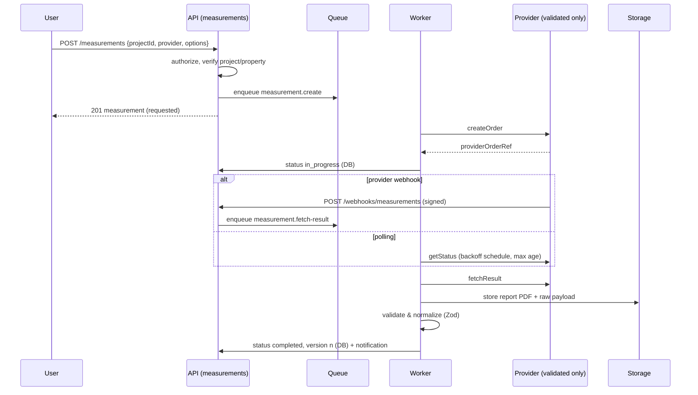

**Manual import:** `POST /measurements/manual-import` with a confirmed PDF `fileId` and normalized values → validated → stored as the next version with `source = manual_import`, status `completed`.

**Failure handling:** each provider call has a timeout (e.g., 15 s), limited retries with exponential backoff for transient errors (5xx, timeouts), no retry for 4xx; final failure sets status `failed` with a safe error message, logs details, notifies the requester and allows `POST /measurements/:id/retry`.

## 13. Invoice and Payment Workflow

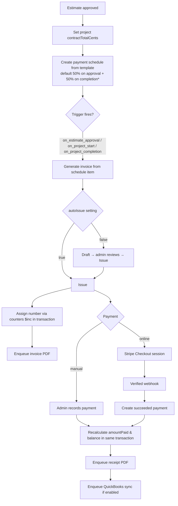
\* Remaining terms pending Q-008.

**Invoice state machine**

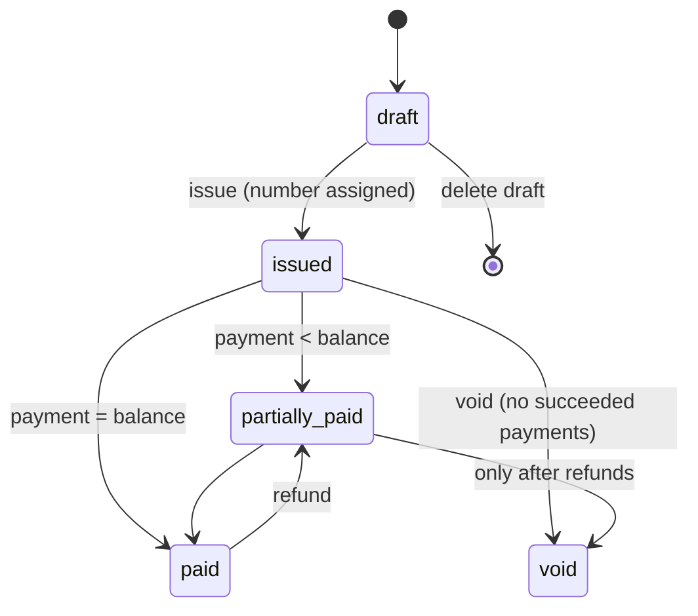

**Estimate state machine**

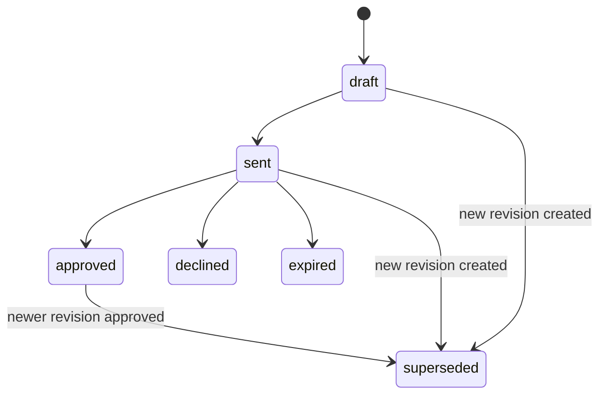

**Rules**

- Schedule amounts: each non-final item `round_cents(total × pctBp/10000)`; the final item = `total − Σ previous` (AC-PAY-1).
- Balance recalculation reads all `succeeded` payments and refunds for the invoice; it never increments a stored number from request input (BR-15).
- Invoice numbering: `counters` document `invoice:<year>` incremented with `findOneAndUpdate({$inc})` inside the issuing transaction → `INV-2026-00001` [P]. Estimates, work orders and material orders use the same numbering service.
- Stripe: server creates a Checkout Session with invoice ID in metadata; client success redirects are informational only; the `payments` record is created only from a verified webhook event, deduplicated by `integrationEvents (provider, eventId)` and `payments (provider, providerPaymentId)`.

## 14. Webhooks, Jobs and Idempotency

- Webhook routes use the raw request body for signature verification, respond quickly (`2xx` after storing the event), and enqueue heavier processing.
- Every inbound event is recorded once in `integrationEvents` (unique `provider,eventId`); duplicates return `200` without reprocessing.
- Jobs are idempotent: they re-read current state and exit if the work is already done.
- Queues: `pdf`, `thumbnails`, `measurements`, `messaging`, `accounting-sync`, `webhooks`, `scheduled` (estimate expiry, pending-upload cleanup). Failed jobs retain error details and are visible in logs/Sentry; business-relevant failures update the related record's status.

## 15. Security Boundaries

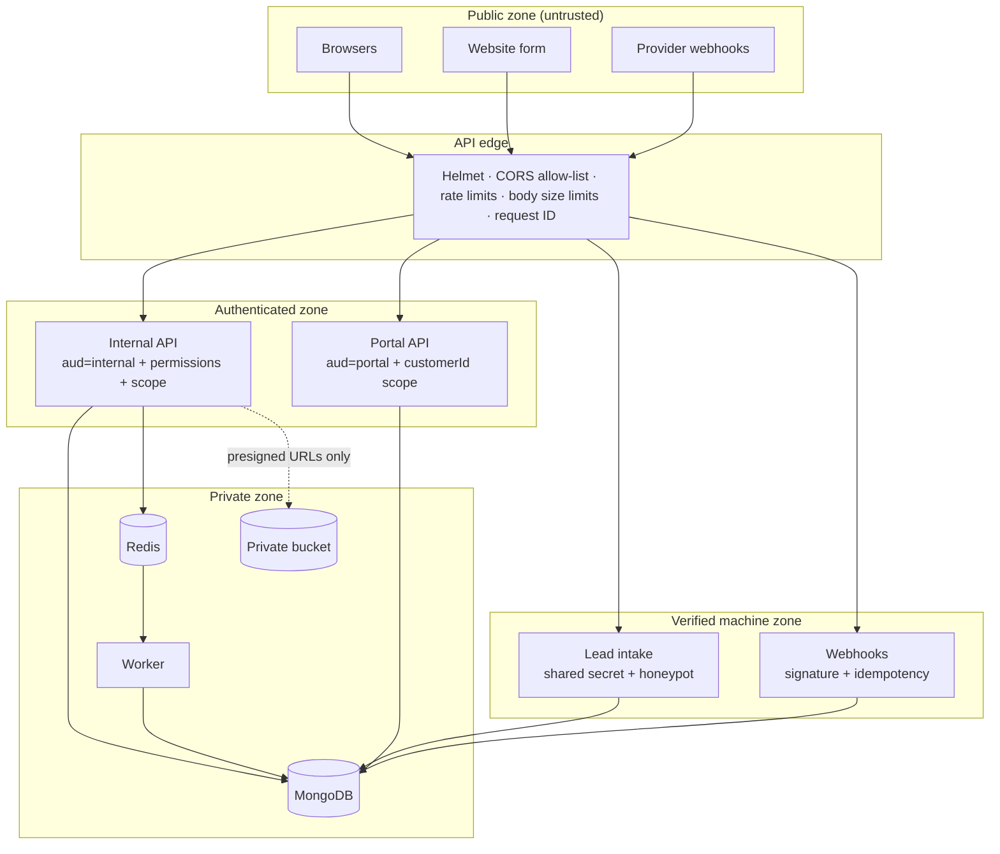

- Database, Redis and bucket are never reachable from browsers except via presigned URLs scoped to one object and a short lifetime.
- Secrets: environment variables loaded and validated by `config/env.ts`; integration OAuth tokens encrypted with `ENCRYPTION_KEY` (AES-256-GCM).
- Logs and Sentry exclude passwords, tokens, full card data (never present), and message bodies; personal data is referenced by ID.
- Error handler maps known `AppError`s to safe responses; unknown errors return a generic 500 with `requestId` and are reported to Sentry.

## 16. Audit Trail

`services/audit.ts` exposes one function used by all modules: `recordAudit({ actor, action, entityType, entityId, changes, session })`. It is called inside the same transaction for financial and permission-relevant actions (AUD-003). Action names follow `<entity>.<verb>` (e.g., `invoice.issued`, `estimate.price_overridden`). The business timeline (`activities`) is separate: it is user-facing and editable for notes, while `auditLogs` is immutable.

## 17. Configuration Over Code

The following are database records, editable by Admin, never constants in code: pipeline stages, lookup lists, tax rates, default waste and margin, estimate expiry days, payment-schedule templates, checklist templates, message templates, catalog prices, company branding and legal texts, lead-assignment settings, invoice numbering prefix/start. Code contains only enums for **system states** (e.g., invoice status) and **stage categories**.

## 18. Proposed CSV Import Workflow (pending client approval)

Applies only if the client approves MIG-001–MIG-011 (Q-021, D-032). Until then, no import code, collection or endpoint is created.

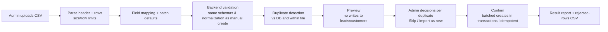

- If approved, adds one collection `importBatches` (type, status `mapping`/`previewed`/`completed`, mapping, defaults, row results, counts, createdBy) and an `importBatchId` field on `leads` and `customers`; ARCHITECTURE §5 and §9 are updated at that time.
- The importer calls the leads and customers **services** (not models), so validation, normalization, duplicate rules and audit entries have a single implementation.
- The CSV parsing approach (and any library) is decided at approval and recorded in DECISIONS.md.

